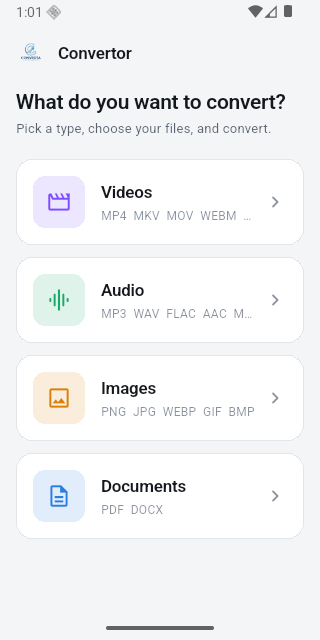
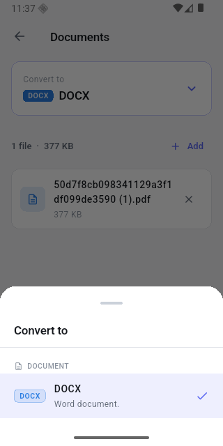
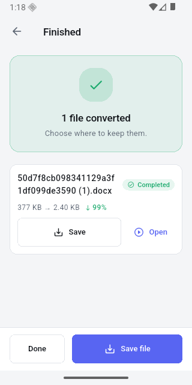
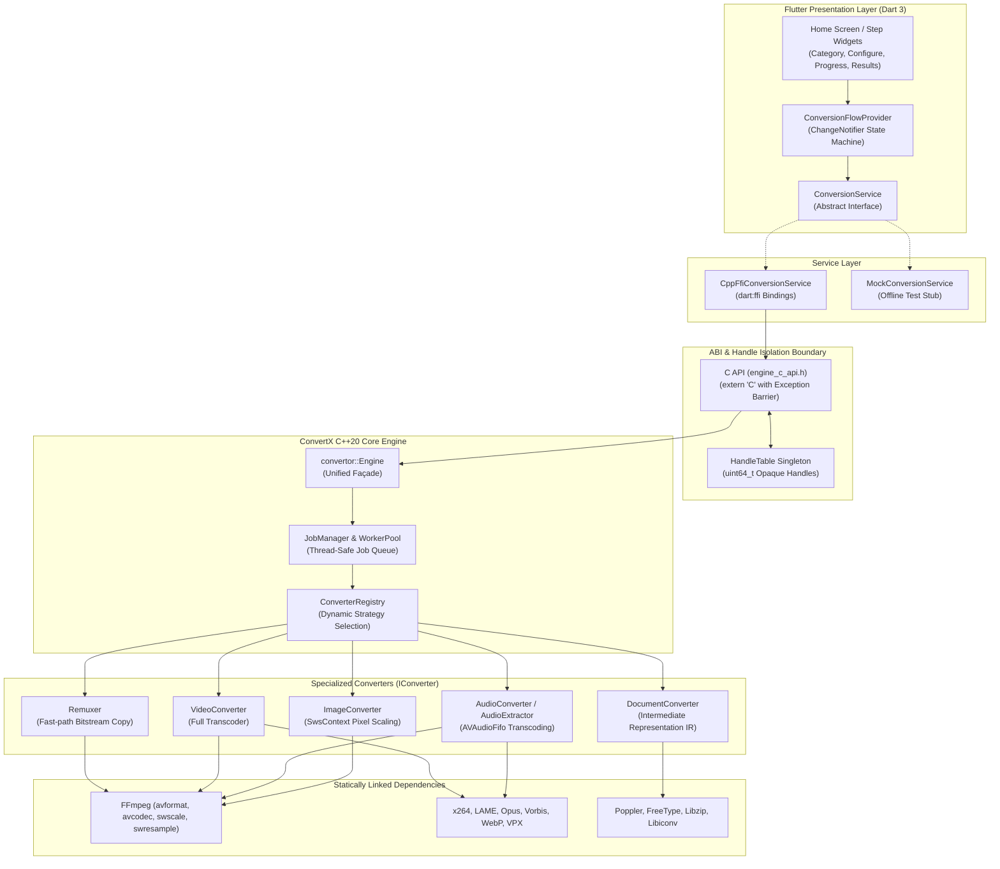
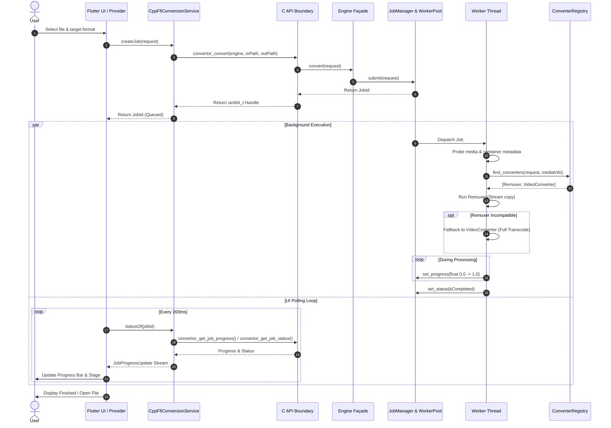
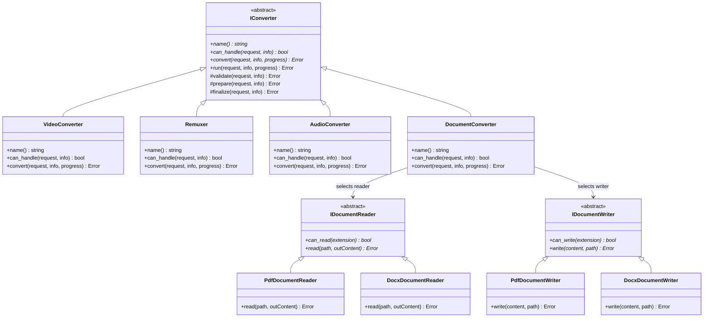

<div align="center">
  
  <h1>ConvertX</h1>
  <p><strong>A high-performance, offline-first media and document converter for Android and Linux.</strong></p>
  <p>Transcode video, audio, images, and documents entirely on local hardware.<br>
  <strong>Zero cloud uploads. Zero background telemetry. Zero account required.</strong> Works seamlessly in airplane mode.</p>

  <p>
    
    
    
    
    
    
  </p>
</div>

<div align="center">
  
  
  
</div>

---

## Table of Contents

- [Why ConvertX?](#why-convertx)
- [Supported Formats Matrix](#supported-formats-matrix)
- [System Architecture](#system-architecture)
  - [High-Level Architecture](#high-level-architecture)
  - [Asynchronous Conversion Lifecycle](#asynchronous-conversion-lifecycle)
  - [Object-Oriented Design & Extensibility](#object-oriented-design--extensibility)
- [Technical Documentation](#technical-documentation)
- [Getting Started & Running](#getting-started--running)
- [Building the Native Engine](#building-the-native-engine)
  - [Desktop (Linux)](#desktop-linux)
  - [Android (NDK Cross-Compilation)](#android-ndk-cross-compilation)
  - [Building Release APKs](#building-release-apks)
- [Command Line Interface (CLI)](#command-line-interface-cli)
- [Repository Structure](#repository-structure)
- [Verification & Testing](#verification--testing)
- [License](#license)

---

## Why ConvertX?

Most converter utilities upload your files to third-party servers. When converting sensitive documents—such as tax statements, boarding passes, legal contracts, or personal videos—remote uploading represents an unacceptable security and privacy risk.

**ConvertX processes everything locally:**
- **Zero Network Traffic:** The native core lacks network sockets entirely.
- **Native Speed:** Built with an ISO C++20 engine leveraging multi-threaded FFmpeg, Poppler, and Libzip.
- **Battery-Conscious Concurrency:** Concurrency limits prevent thermal throttling on mobile devices.
- **Self-Contained Deployment:** On Android, every codec and dependency is statically compiled into a single self-contained `libconvertor.so` per ABI.

---

## Supported Formats Matrix

| Category | Input Formats | Target Outputs |
|---|---|---|
| **Video** | MP4, MKV, MOV, WebM, AVI, WMV, FLV, TS, M4V, 3GP, MPEG, OGV | Any supported video container, or extract to any audio format |
| **Audio** | MP3, WAV, FLAC, AAC, OGG, M4A, Opus, WMA, AIFF | MP3, WAV, FLAC, AAC, OGG, M4A, Opus |
| **Images** | JPG, PNG, GIF, BMP, WebP, TIFF, ICO, AVIF | Any supported image format, or single-page/multi-page PDF |
| **Documents** | PDF, Microsoft Word (DOCX) | Bidirectional conversion (PDF $\leftrightarrow$ DOCX) |

> **Deliberate Design Decisions:**
> 1. **No arbitrary video-to-single-frame conversions:** Pulling a single frame out of a video is rarely what users actually need.
> 2. **Documents focus on Word $\leftrightarrow$ PDF:** These two formats represent the vast majority of critical document workflows and are prioritized for high-fidelity conversion.
> 3. **The Format Catalog guarantees truth:** A continuous-integration test asserts that the UI never displays options that the native engine cannot process.

---

## System Architecture

ConvertX utilizes a clean separation of concerns: a modern **Flutter/Dart** interface communicates with an **ISO C++20 engine** across a pure C Application Binary Interface (`dart:ffi`).

### High-Level Architecture



---

### Asynchronous Conversion Lifecycle

The Flutter UI submits asynchronous conversion requests and polls state updates over an FFI boundary while background workers execute the transformation:



---

### Object-Oriented Design & Extensibility

ConvertX is engineered using modern OOP principles and design patterns:
- **Template Method Pattern:** `IConverter::run()` guarantees a 4-step pipeline: `validate()` $\to$ `prepare()` $\to$ `convert()` $\to$ `finalize()`.
- **Intermediate Representation (IR):** The document subsystem separates reading (`IDocumentReader`) from writing (`IDocumentWriter`) using `DocumentContent`, reducing $M \times N$ format combinations to an extensible $M + N$ architecture.
- **Façade Pattern:** `convertor::Engine` hides threading, worker queues, and codec initialization behind a clean public interface.



---

## Technical Documentation

For an exhaustive, 10-page engineering guide covering:
- In-depth **Object-Oriented Programming (OOP)** foundations (Abstraction, Encapsulation, Polymorphism, Inheritance),
- Complete **SOLID principles** breakdown with code case studies,
- GoF Design Patterns analysis (Template Method, Façade, Builder, Registry, Strategy, Adapter, Observer, RAII),
- Intermediate Representation & Document Transformation mechanics,
- Audio FIFO sample alignment and packet decoding internals,
- Dart FFI memory boundaries and the C++ Exception Barrier,

👉 **Read the comprehensive [Technical Documentation (docs/TECHNICAL_DOCUMENTATION.md)](docs/TECHNICAL_DOCUMENTATION.md)**  
👉 **Read the engine design notes in [engine/ARCHITECTURE.md](engine/ARCHITECTURE.md)**

---

## Getting Started & Running

### Prerequisites

- [Flutter SDK](https://flutter.dev/) (v3.13.0 or later)
- Android SDK & NDK (for Android compilation) or GCC/Clang with CMake (for Linux desktop)

### Running the App

```bash
cd offlineconvertor
flutter pub get

# Run on an Android device or emulator
flutter run -d android

# Run natively on Linux desktop
flutter run -d linux
```

> **Note:** Prebuilt native binaries for `libconvertor.so` are included in the repository. You can clone and run the Flutter application immediately without compiling C++.
>
> If you encounter a warning that *"the conversion engine is not connected"*, the app was unable to load `libconvertor.so` and fell back to the mock engine. Follow the build instructions below to compile the native library for your platform.

---

## Building the Native Engine

### Desktop (Linux)

Install the required development libraries:
```bash
# Debian / Ubuntu
sudo apt install build-essential cmake pkg-config \
    libavformat-dev libavcodec-dev libavutil-dev libswscale-dev libswresample-dev \
    libpoppler-cpp-dev libzip-dev
```

Build the engine and copy the shared library to the Flutter runner:
```bash
cd engine
cmake -B build
cmake --build build -j$(nproc)

# Copy the built shared library for Flutter desktop
cp build/libconvertor.so.1.0.0 ../offlineconvertor/linux/libconvertor.so
```

### Android (NDK Cross-Compilation)

Android does not ship FFmpeg, Poppler, or Libzip. ConvertX cross-compiles all 12 libraries from source using the NDK.

Execute the build scripts in order for your target architecture (`arm64-v8a` for physical hardware, `x86_64` for emulators):

```bash
cd engine/android

# Build for modern 64-bit ARM devices
./scripts/build_x264.sh    arm64-v8a   # H.264 video encoder
./scripts/build_codecs.sh  arm64-v8a   # LAME, Vorbis, Opus, WebP, VP8/VP9
./scripts/build_docdeps.sh arm64-v8a   # libiconv, FreeType, libzip, Poppler
./scripts/build_ffmpeg.sh  arm64-v8a   # FFmpeg compiled against all codecs above
./scripts/build_engine.sh  arm64-v8a   # Compiles libconvertor.so -> jniLibs/arm64-v8a/
```

> For comprehensive details on NDK symbol visibility flags (`-Wl,--exclude-libs,ALL`) and cross-compilation quirks, consult **[engine/android/README.md](engine/android/README.md)**.

### Building Release APKs

```bash
cd offlineconvertor
rm -f android/app/src/main/java/io/flutter/plugins/GeneratedPluginRegistrant.java
flutter build apk --release --target-platform android-arm64,android-x64
```

> **Important:** Always remove `GeneratedPluginRegistrant.java` prior to release builds. Test runs generate integration stubs that break release Gradle compilations. Avoid running `flutter test` and `flutter build` concurrently.

---

## Command Line Interface (CLI)

The C++ build produces `convertor_cli`, allowing standalone conversions, stream inspection, and automated testing without launching Flutter:

```bash
cd engine/build

# Convert documents or media files
./convertor_cli convert input.pdf output.docx
./convertor_cli convert input.mp4 output.mkv

# Probe multimedia streams, dimensions, and codecs
./convertor_cli probe sample.mp4

# Inspect the engine's active format catalog
./convertor_cli formats
```

---

## Repository Structure

```
ConvertX/
├── docs/                        # Architecture documentation, diagrams & screenshots
│   ├── TECHNICAL_DOCUMENTATION.md # 10-page comprehensive engineering & OOP specification
│   └── screenshots/             # Application UI screenshots
│
├── engine/                      # Core C++20 conversion engine
│   ├── include/convertor/       # Public engine headers & flat C ABI (engine_c_api.h)
│   ├── src/
│   │   ├── core/                # FormatCatalog, ErrorCode, MediaInfo (zero dependencies)
│   │   ├── fs/                  # Path utilities & RAII TempFile management
│   │   ├── ffmpeg/              # RAII wrappers for AVFormatContext, AVCodecContext, Sws/Swr
│   │   ├── document/            # Converters (IConverter), Intermediate Representation, Poppler & Libzip
│   │   ├── jobs/                # JobManager, WorkerPool, JobQueue, thread synchronization
│   │   └── ffi/                 # C-API implementation & HandleTable pointer bridge
│   ├── tools/                   # convertor_cli standalone executable
│   ├── android/                 # NDK automated cross-compilation toolchains
│   └── tests/                   # Native GoogleTest suites
│
└── offlineconvertor/            # Flutter client application
    ├── lib/
    │   ├── core/                # FormatCatalog mirror, theme, utilities
    │   ├── models/              # Immutable Dart domain models (FileFormat, ConversionRequest, etc.)
    │   ├── providers/           # ConversionFlowProvider (state machine)
    │   ├── services/            # ConversionService (Abstract interface, CppFfi, Mock)
    │   └── features/home/       # UI Steps: Category -> Configure -> Progress -> Results
    ├── test/                    # Dart unit tests & FFI matrix verification
    └── integration_test/        # End-to-end device integration test suite
```

---

## Verification & Testing

ConvertX enforces rigorous quality and safety guarantees:

```bash
# 1. Run engine C++ unit tests
cd engine/build && ./convertor_tests

# 2. Run Dart unit & catalog consistency tests
cd offlineconvertor && flutter test

# 3. Run on-device integration tests
flutter test integration_test/ -d <device_id>
```

### Architectural Testing Invariants

- **Drift Prevention Guarantee:** `format_catalog_test.dart` queries the engine's advertised matrix and validates that Dart's catalog never deviates from native support.
- **Deep Semantic Validation:** Every conversion test decodes output frames and verifies headers rather than merely asserting non-zero file creation:
  - Audio and video files are fully decoded with packet timestamps checked.
  - Image outputs are verified against magic byte signatures.
  - PDFs are parsed with Poppler to verify page tree validity.
  - Word documents are unpacked as ZIP archives to check OOXML schemas.

**Current Test Status:** **258 conversion vectors pass on Linux** with verified output semantics, and **26 vectors pass on Android emulators** alongside the full integration test suite.

---

## License

ConvertX is open-source software licensed under the **GNU General Public License v3.0 (GPLv3)** due to static linkage with the `libx264` high-performance H.264 video encoder.
