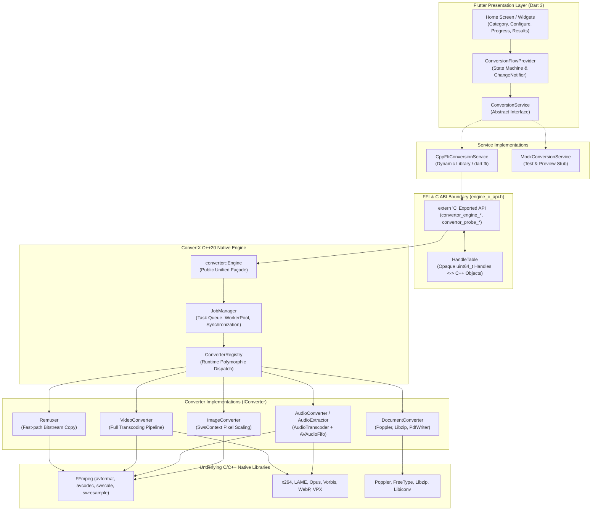
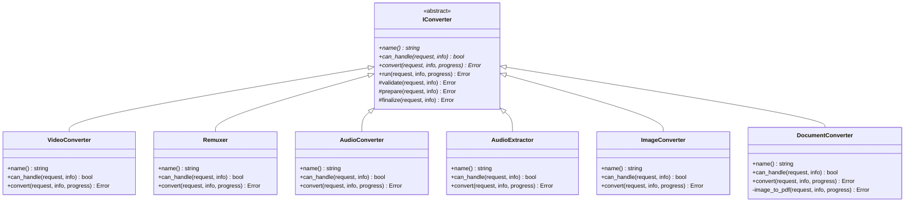
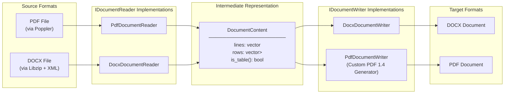
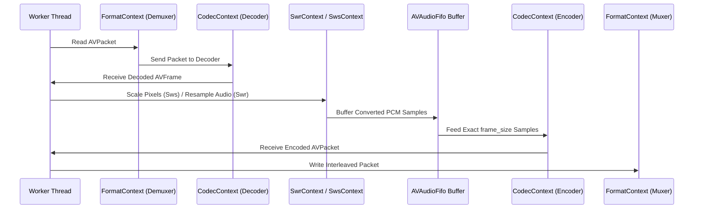

# ConvertX — Comprehensive Technical Documentation & Architecture Specification

> **System Engineering, Object-Oriented Design Principles, and Core Subsystems**  
> **Document Version:** 1.0.0  
> **Target Platforms:** Android (arm64-v8a, x86_64), Linux (x86_64 desktop)  
> **Core Technologies:** C++20, Dart 3, Flutter, FFmpeg (libav*), Poppler, Libzip, Dart FFI  

---

## Table of Contents

1. [Executive Summary & Architectural Philosophy](#1-executive-summary--architectural-philosophy)
2. [End-to-End System Topology & Layering Boundaries](#2-end-to-end-system-topology--layering-boundaries)
3. [Object-Oriented Programming (OOP) Fundamentals in ConvertX](#3-object-oriented-programming-oop-fundamentals-in-convertx)
   - [3.1 Abstraction](#31-abstraction)
   - [3.2 Encapsulation & Information Hiding](#32-encapsulation--information-hiding)
   - [3.3 Inheritance & Class Hierarchies](#33-inheritance--class-hierarchies)
   - [3.4 Polymorphism & Dynamic Dispatch](#34-polymorphism--dynamic-dispatch)
4. [SOLID Design Principles in Practice](#4-solid-design-principles-in-practice)
   - [4.1 Single Responsibility Principle (SRP)](#41-single-responsibility-principle-srp)
   - [4.2 Open/Closed Principle (OCP)](#42-openclosed-principle-ocp)
   - [4.3 Liskov Substitution Principle (LSP)](#43-liskov-substitution-principle-lsp)
   - [4.4 Interface Segregation Principle (ISP)](#44-interface-segregation-principle-isp)
   - [4.5 Dependency Inversion Principle (DIP)](#45-dependency-inversion-principle-dip)
5. [Design Patterns Catalog](#5-design-patterns-catalog)
   - [5.1 Template Method Pattern (`IConverter`)](#51-template-method-pattern-iconverter)
   - [5.2 Façade Pattern (`convertor::Engine`)](#52-façade-pattern-convertorengine)
   - [5.3 Builder Pattern (`ConversionRequestBuilder`)](#53-builder-pattern-conversionrequestbuilder)
   - [5.4 Registry & Strategy Pattern (`ConverterRegistry`)](#54-registry--strategy-pattern-converterregistry)
   - [5.5 Adapter & Bridge Pattern (`CppFfiConversionService`)](#55-adapter--bridge-pattern-cppfficonversionservice)
   - [5.6 Observer Pattern (Progress Stream & Flow Provider)](#56-observer-pattern-progress-stream--flow-provider)
   - [5.7 RAII (Resource Acquisition Is Initialization)](#57-raii-resource-acquisition-is-initialization)
6. [The Document Transformation Pipeline & Intermediate Representation](#6-the-document-transformation-pipeline--intermediate-representation)
7. [The Multimedia Transcoding & Remuxing Subsystem](#7-the-multimedia-transcoding--remuxing-subsystem)
8. [Concurrency, Thread Pooling, and Job Lifecycle](#8-concurrency-thread-pooling-and-job-lifecycle)
9. [Cross-Language Boundary: Dart FFI & C ABI Engineering](#9-cross-language-boundary-dart-ffi--c-abi-engineering)
10. [Cross-Platform Native Build Pipeline & NDK Linking](#10-cross-platform-native-build-pipeline--ndk-linking)
11. [Verification, Robustness Guarantees, and Invariants](#11-verification-robustness-guarantees-and-invariants)

---

## 1. Executive Summary & Architectural Philosophy

**ConvertX** is an offline-first, zero-trust media and document conversion system designed for mobile (Android) and desktop (Linux) operating systems. The foundational requirement of the project is absolute data sovereignty: **no user data, media packets, or document streams ever leave the physical device**. All parsing, transcoding, text extraction, rasterization, and container muxing are executed on local hardware using native machine instructions.

Modern conversion applications frequently offload heavy computation to remote server farms. This introduces major security vulnerabilities, network bandwidth consumption, privacy exposure (e.g., transmitting sensitive tax forms, boarding passes, or personal videos), and total dependency on network availability. ConvertX solves this by compiling an enterprise-grade multimedia processing engine (`libconvertor.so`) directly into native code and embedding it within a modern Flutter client.

### Key Architectural Invariants

1. **Zero Network Transmission:** The native engine contains no networking stack, sockets, or telemetry. It operates identically in airplane mode.
2. **Deterministic Memory Footprint:** Multimedia streams are processed in a streaming, packetized fashion using bounded queues and RAII owners rather than reading entire large files into memory.
3. **No Drift Between UI and Core:** The target format matrix exposed to the user in Flutter is synchronized with the engine's internal `FormatCatalog` via automated verification tests.
4. **Deep Semantic Output Validation:** Test suites do not merely assert file presence or non-zero byte size; they parse output magic bytes, decode container headers, validate ZIP structure, and execute Poppler re-parsing to verify semantic integrity.

---

## 2. End-to-End System Topology & Layering Boundaries

The ConvertX repository is partitioned into two distinct technological domains connected by a thin, C-compatible application binary interface (ABI):

1. **The Native Core Engine (`engine/`):** Written in ISO modern C++20. Manages decoding, encoding, transcoding, document parsing, thread pooling, and hardware utilization.
2. **The Reactive User Interface (`offlineconvertor/`):** Written in Dart 3 and Flutter. Manages platform file pickers (Android Storage Access Framework), user configuration, reactive state, and progress visualization.



### The Strict Dependency Inversion & Layering Rule

The C++20 engine strictly enforces a one-way downward dependency DAG. Violations of this hierarchy will fail continuous integration checks:

$$\text{tools/ (CLI)} \;\lor\; \text{ffi/ (C API)} \longrightarrow \text{jobs/} \longrightarrow \text{document/} \longrightarrow \text{ffmpeg/} \longrightarrow \text{fs/} \longrightarrow \text{core/}$$

- **`core/`**: Defines primitives (`ErrorCode`, `Error`, `Result<T>`, `MediaInfo`, `FormatCatalog`, `LogLevel`). Contains zero dependencies on other engine modules or external multimedia libraries.
- **`fs/`**: Handles filesystem manipulations, path decomposition, and auto-deleting RAII temporary files (`TempFile`).
- **`ffmpeg/`**: **The only module permitted to include FFmpeg C headers (`libavcodec/*.h`, `libavformat/*.h`).** It wraps every C struct in modern C++20 RAII objects.
- **`document/`**: Implements concrete converters, document readers, and document writers. Does not know that a thread pool or queue exists.
- **`jobs/`**: Manages concurrency (`WorkerPool`, `JobQueue`, `JobManager`). Interacts with converters exclusively through the abstract `IConverter` interface and callback lambdas.
- **`ffi/`**: Implements the flat `extern "C"` functions exposed to Dart. Translates C++ exceptions into error return codes.

---

## 3. Object-Oriented Programming (OOP) Fundamentals in ConvertX

The architecture of ConvertX demonstrates rigorous application of classical and modern Object-Oriented Programming principles across both C++20 and Dart.



### 3.1 Abstraction

Abstraction is the deliberate suppression of irrelevant low-level details in favor of essential operational qualities. In ConvertX, abstraction operates at every architectural junction:

1. **Abstracting C Procedural Multimedia APIs:**
   The underlying multimedia libraries (FFmpeg's `libavformat`, `libavcodec`) are written in procedural C, exposing manually-allocated structs (`AVFormatContext*`, `AVCodecContext*`, `AVPacket*`, `AVFrame*`) and hundreds of return codes. ConvertX abstracts this complexity into semantic C++ types:
   ```cpp
   // High-level abstraction for format demuxing/muxing
   class FormatContext {
   public:
       static Result<FormatContext> open_input(const std::string& url);
       static Result<FormatContext> open_output(const std::string& url, const std::string& format_name);
       // Internal low-level AVFormatContext* is completely hidden
   };
   ```
2. **Abstracting the Conversion Pipeline via `IConverter`:**
   High-level job runners do not need to know whether a conversion involves H.264 video decoding, Poppler PDF text layout, or Libzip archive extraction. All operations are abstracted through pure virtual contracts:
   ```cpp
   class IConverter {
   public:
       virtual ~IConverter() = default;
       virtual std::string name() const = 0;
       virtual bool can_handle(const ConversionRequest& request, const MediaInfo& input_info) const = 0;
       virtual Error convert(const ConversionRequest& request, const MediaInfo& input_info, ProgressCallback progress) = 0;
   };
   ```
3. **Dart Service Abstraction:**
   In the Flutter layer, widgets and controllers code strictly against `abstract interface class ConversionService`. The UI is completely agnostic of whether it is communicating with native shared libraries via `dart:ffi` or running against in-memory mocks.

### 3.2 Encapsulation & Information Hiding

Encapsulation ensures that the internal state of an object is shielded from external mutation, accessible only through strictly validated member functions.

1. **Guarding Request Construction (`ConversionRequestBuilder`):**
   A `ConversionRequest` requires valid file paths, validated codec configurations, and format-specific settings. Rather than exposing mutable fields, `ConversionRequestBuilder` encapsulates state accumulation:
   ```cpp
   class ConversionRequestBuilder {
   private:
       std::string input_path_;
       std::string output_path_;
       ConversionSettings settings_;
   public:
       ConversionRequestBuilder& from(const std::string& path) {
           input_path_ = path;
           return *this;
       }
       ConversionRequestBuilder& to(const std::string& path) {
           output_path_ = path;
           return *this;
       }
       ConversionRequest build() const {
           if (input_path_.empty() || output_path_.empty()) {
               throw std::runtime_error("Input and output paths are required");
           }
           return ConversionRequest(input_path_, output_path_, settings_);
       }
   };
   ```
2. **FFI Handle Table & Pointer Isolation:**
   Exposing raw C++ memory pointers to Dart across the FFI boundary risks memory corruption, dangling pointer dereferences, and double-free vulnerabilities. ConvertX encapsulates all living native instances within `HandleTable`:
   ```cpp
   class HandleTable {
   public:
       static HandleTable& instance();
       uint64_t insert(void* ptr);
       void* get(uint64_t handle) const;
       void erase(uint64_t handle);
   private:
       mutable std::mutex mutex_;
       std::unordered_map<uint64_t, void*> handles_;
       uint64_t next_ = 1;
   };
   ```
   Dart only ever receives an opaque 64-bit integer (`uint64_t`). If an invalid handle is sent, the engine safely rejects it without memory faults.

3. **Strict Translation Unit Encapsulation:**
   The `src/ffmpeg/` directory encapsulates all FFmpeg include directives. Neither `document/`, `jobs/`, nor `ffi/` include `<libavformat/avformat.h>`. An upgrade or alteration of FFmpeg APIs affects only the isolated wrapper implementations.

### 3.3 Inheritance & Class Hierarchies

Inheritance is utilized across ConvertX to share common behaviors, enforce interface compliance, and structure domain relationships:

1. **Converter Specialization:**
   `IConverter` is the root base class. Its derived classes specialize conversion mechanics:
   - `Remuxer`: Re-packages container bitstreams without re-encoding codecs (e.g., MP4 to MKV).
   - `VideoConverter`: Implements full demuxing, decoding, frame rescaling via `SwsContext`, encoding, and muxing.
   - `AudioConverter`: Executes audio decoding, sample rate/channel conversion via `SwrContext`, and encoding.
   - `AudioExtractor`: Strips audio tracks from video containers and converts them to pure audio formats.
   - `ImageConverter`: Transcodes raster images across codecs (JPEG, PNG, WebP).
   - `DocumentConverter`: Handles Word (.docx) to PDF conversion, PDF to Word conversion, and image-to-PDF wrapping.

2. **Document Processing Reader/Writer Hierarchy:**
   To prevent combinatorial explosion ($M$ input formats $\times$ $N$ output formats), ConvertX separates reading from writing using dedicated class hierarchies:
   ```cpp
   // Base reader contract
   class IDocumentReader {
   public:
       virtual ~IDocumentReader() = default;
       virtual std::string name() const = 0;
       virtual bool can_read(const std::string& extension) const = 0;
       virtual Error read(const std::string& path, DocumentContent& out) = 0;
   };

   // Derived concrete readers
   class PdfDocumentReader : public IDocumentReader { ... };
   class DocxDocumentReader : public IDocumentReader { ... };

   // Base writer contract
   class IDocumentWriter {
   public:
       virtual ~IDocumentWriter() = default;
       virtual std::string name() const = 0;
       virtual bool can_write(const std::string& extension) const = 0;
       virtual Error write(const DocumentContent& content, const std::string& path) = 0;
   };

   // Derived concrete writers
   class PdfDocumentWriter : public IDocumentWriter { ... };
   class DocxDocumentWriter : public IDocumentWriter { ... };
   class XlsxDocumentWriter : public IDocumentWriter { ... };
   class OdtDocumentWriter : public IDocumentWriter { ... };
   class PlainTextDocumentWriter : public IDocumentWriter { ... };
   ```

### 3.4 Polymorphism & Dynamic Dispatch

Polymorphism allows algorithms to operate on abstract types while dynamic dispatch resolves the concrete implementation at runtime via virtual method tables (`vtable`):

1. **Polymorphic Converter Dispatch in `JobManager`:**
   When a user requests a conversion (e.g., `.mov` to `.mp4`), the engine queries `ConverterRegistry`. The registry returns a collection of `IConverter*` pointers capable of handling the request. `JobManager` iterates over these pointers polymorphically:
   ```cpp
   for (IConverter* converter : candidate_converters) {
       Error err = converter->run(request, info, progress_cb);
       if (err.ok()) {
           job->set_status(JobStatus::kCompleted);
           return;
       }
       // Fall back to subsequent candidate (e.g., from Remuxer to VideoConverter)
   }
   ```
2. **Polymorphic Document Parsing & Generation:**
   `DocumentConverter::convert` never checks format switch statements directly. Instead, it delegates to `DocumentReaderRegistry` and `DocumentWriterRegistry`:
   ```cpp
   IDocumentReader* reader = DocumentReaderRegistry::instance().find_reader(in_ext);
   IDocumentWriter* writer = DocumentWriterRegistry::instance().find_writer(out_ext);

   DocumentContent content;
   Error err = reader->read(request.input_path(), content);
   if (!err.ok()) return err;

   return writer->write(content, request.output_path());
   ```

---

## 4. SOLID Design Principles in Practice

ConvertX's maintainability, testability, and stability stem from rigorous application of the five SOLID design principles:

### 4.1 Single Responsibility Principle (SRP)
> *"A class should have one, and only one, reason to change."*

- **Document Processing Separation:** Parsing a PDF via Poppler (`PdfDocumentReader`) is strictly separated from serializing a DOCX package via Libzip (`DocxDocumentWriter`). Changes to the Microsoft Office Open XML specification affect only `DocxDocumentWriter`, leaving PDF logic completely untouched.
- **Transcoding vs Synchronization:** `AudioTranscoder` is exclusively responsible for decoding audio packets, resampling through `SwrContext`, and feeding exact-size sample buffers into `AVAudioFifo`. It has no knowledge of thread pools, file paths, or UI updates.
- **Job Coordination vs Worker Execution:** `JobManager` orchestrates high-level job state transitions (`kQueued`, `kRunning`, `kCompleted`). Thread management is delegated to `WorkerPool`, and FIFO task scheduling is delegated to `JobQueue`.

### 4.2 Open/Closed Principle (OCP)
> *"Software entities should be open for extension, but closed for modification."*

- Adding a new document format (e.g., Markdown `.md` or OpenDocument `.odt`) requires **zero modifications** to `DocumentConverter` or existing readers/writers. The engineer simply creates a new class implementing `IDocumentWriter` and registers it with `DocumentWriterRegistry::instance().register_writer(...)`.
- Similarly, introducing a new media acceleration path (e.g., Vulkan or VAAPI-based video decoding) requires creating a derived `IConverter` and registering it with `ConverterRegistry`.

### 4.3 Liskov Substitution Principle (LSP)
> *"Subtypes must be substitutable for their base types without altering program correctness."*

- In C++, every derived `IConverter` fulfills the behavioral contract of `IConverter::run()`. Regardless of whether `Remuxer` completes a stream copy in 15 milliseconds or `VideoConverter` executes a full software transcode over 30 seconds, callers treat them identically.
- In Dart, `MockConversionService` is completely substitutable for `CppFfiConversionService`. All unit and widget test suites execute against the mock service without changing a single line of business logic or UI code:
  ```dart
  ConversionService service = _buildConversionService();
  // Can be CppFfiConversionService or MockConversionService seamlessly
  await service.initialize();
  final jobId = await service.createJob(request);
  ```

### 4.4 Interface Segregation Principle (ISP)
> *"Clients should not be forced to depend upon interfaces they do not use."*

- Instead of defining a massive, monolithic `IDocumentEngine` containing `read_pdf()`, `write_pdf()`, `read_docx()`, and `write_docx()`, ConvertX defines lean, cohesive interfaces: `IDocumentReader` (declaring only `can_read` and `read`) and `IDocumentWriter` (declaring only `can_write` and `write`).
- A format that can only be written (e.g., a pure output report format) does not need to provide dummy or exception-throwing implementations of read methods.

### 4.5 Dependency Inversion Principle (DIP)
> *"High-level modules should not depend on low-level modules. Both should depend on abstractions."*

- The Flutter UI layer does not depend on `CppFfiConversionService` or the native dynamic library. It depends solely on the abstract `ConversionService` interface.
- Construction and injection occur exclusively at the **Composition Root** in `main.dart`:
  ```dart
  final ConversionService conversionService = _buildConversionService();
  runApp(
    MultiProvider(
      providers: [
        Provider<ConversionService>.value(value: conversionService),
        ChangeNotifierProvider(
          create: (_) => ConversionFlowProvider(conversionService: conversionService),
        ),
      ],
      child: const ConvertorApp(),
    ),
  );
  ```

---

## 5. Design Patterns Catalog

ConvertX implements classic Gang of Four (GoF) design patterns to solve common architectural challenges:

| Design Pattern | Category | ConvertX Implementation | Purpose / Architectural Benefit |
|---|---|---|---|
| **Template Method** | Behavioral | `IConverter::run()` | Defines fixed algorithm skeleton: validate $\to$ prepare $\to$ convert $\to$ finalize. |
| **Façade** | Structural | `convertor::Engine` | Unifies probing, conversion, job scheduling, and lifecycle into a clean public API. |
| **Builder** | Creational | `ConversionRequestBuilder` | Step-by-step construction of complex conversion requests with fluent method chaining. |
| **Registry** | Structural | `ConverterRegistry`, `DocumentReaderRegistry` | Centralized lookup and dynamic discovery of polymorphic conversion strategies. |
| **Strategy & Fallback** | Behavioral | Remuxer $\to$ VideoConverter | Tries near-instant stream copy first; cascades down to full transcode if container rejects codec. |
| **Adapter** | Structural | `CppFfiConversionService` | Adapts procedural C functions and raw FFI pointers to Dart asynchronous Streams/Futures. |
| **Observer** | Behavioral | `ConversionFlowProvider` & Progress Callbacks | Propagates conversion progress from native encoder loops up to reactive UI widgets. |
| **RAII / Smart Deleter** | Idiomatic C++ | `FormatContext`, `CodecContext`, `Frame`, `TempFile` | Guarantees deterministic resource cleanup and zero memory/file descriptor leaks. |
| **Handle Table** | Structural | `ffi::HandleTable` | Maps internal C++ pointers to opaque 64-bit integer handles across the ABI boundary. |

### 5.1 Template Method Pattern (`IConverter`)

The `IConverter` abstract base class standardizes the execution flow of all conversions using the Template Method design pattern:

```cpp
Error IConverter::run(const ConversionRequest& request,
                      const MediaInfo& input_info,
                      ProgressCallback progress) {
    // Stage 1: Validate preconditions
    Error err = validate(request, input_info);
    if (!err.ok()) return err;

    // Stage 2: Prepare hardware/memory resources
    err = prepare(request, input_info);
    if (!err.ok()) return err;

    // Stage 3: Execute core conversion (Pure Virtual)
    err = convert(request, input_info, progress);
    if (!err.ok()) return err;

    // Stage 4: Finalize, flush headers, verify output integrity
    return finalize(request, input_info);
}
```
Subclasses override specific protected hooks (`validate()`, `prepare()`, `finalize()`) if needed, while `convert()` remains pure virtual. This ensures consistent error checking and lifecycle guarantees across all converters.

### 5.2 Façade Pattern (`convertor::Engine`)

The native engine contains extensive internal subsystems: `JobManager`, `WorkerPool`, `JobQueue`, `ConverterRegistry`, `MediaProber`, and various format readers. The `Engine` class acts as a single, cohesive Façade:

```cpp
namespace convertor {
class Engine {
public:
    Engine();
    ~Engine();

    void initialize();
    void shutdown();

    MediaInfo probe(const std::string& path, Error& err);
    JobId convert(ConversionRequest request, JobCallback callback = nullptr);
    ConversionResult convert_sync(const ConversionRequest& request, Error& err);
    bool cancel_job(JobId id);
    std::shared_ptr<Job> get_job(JobId id) const;

private:
    std::unique_ptr<JobManager> job_manager_;
    bool initialized_ = false;
};
}
```
External consumers (such as CLI tools or the FFI boundary) interact exclusively with `Engine`, completely insulated from internal queue locking, thread synchronization, or converter selection mechanics.

### 5.3 Builder Pattern (`ConversionRequestBuilder`)

Building a conversion request involves dozens of optional audio and video parameters (bitrates, codecs, dimensions, CRF values, sample rates). The Builder pattern encapsulates this construction:

```cpp
auto request = ConversionRequestBuilder()
    .from("/storage/emulated/0/DCIM/sample.mov")
    .to("/storage/emulated/0/Download/converted.mp4")
    .with_video_codec("libx264")
    .with_video_crf(22)
    .with_video_resolution(1920, 1080)
    .with_audio_codec("aac")
    .with_audio_bitrate(192000)
    .build();
```

### 5.4 Strategy & Fallback Selection (`ConverterRegistry`)

The `ConverterRegistry` maintains converter strategies in priority order. When a video container conversion is requested, the registry returns all compatible converters:

```
Fast-Path Strategy (Remuxer: Stream Copy)
                │
                ▼ (Fails if codec incompatible with container)
Fallback Strategy (VideoConverter: Full Transcode)
```

1. **`Remuxer` (Fast-Path):** Attempts direct bitstream packet copying without decoding or re-encoding. This completes in milliseconds with zero generation loss.
2. **`VideoConverter` (Fallback):** If the target container rejects the source codec (e.g., moving VP9 video into an MP4 container without AV1/H.264), `Remuxer` rejects the stream or fails during header setup, and the job automatically cascades to full video re-encoding.

---

## 6. The Document Transformation Pipeline & Intermediate Representation

Traditional multi-format converters implement discrete conversion routines for every supported pair. For $N$ formats, this requires $\mathcal{O}(N^2)$ converters. ConvertX eliminates this architectural bottleneck by establishing an **Intermediate Representation (IR)**: `DocumentContent`.



### The `DocumentContent` Model

```cpp
struct DocumentContent {
    std::vector<std::string> lines;
    std::vector<std::vector<std::string>> rows;

    bool is_table() const { return !rows.empty(); }
    bool empty() const { return lines.empty() && rows.empty(); }
};
```

1. **Decoupled Complexity:** Adding a new format requires only $1$ Reader and $1$ Writer, reducing complexity from $\mathcal{O}(N^2)$ to $\mathcal{O}(N)$.
2. **Zero-Dependency PDF 1.4 Writer:** While PDF reading requires Poppler, **PDF writing in ConvertX is completely custom (`pdf_writer.cpp`)**. It synthesizes raw PDF 1.4 syntax, builds object streams, generates cross-reference tables (`xref`), computes page catalog dictionaries, executes WinAnsi character mapping, and wraps images directly into PDF pages without any external library.
3. **DOCX Generation via Libzip:** `DocxDocumentWriter` creates valid Open Packaging Conventions (OPC) ZIP archives, injecting required parts: `[Content_Types].xml`, `_rels/.rels`, and `word/document.xml`.

---

## 7. The Multimedia Transcoding & Remuxing Subsystem

For video, audio, and raster images, ConvertX implements a high-performance multimedia pipeline built upon FFmpeg wrappers:



### The Audio FIFO Problem and Solution

Certain audio encoders (notably MP3 via `libmp3lame`) require an exact number of samples per input frame (e.g., exactly 1152 samples per frame). Demuxed audio packets from containers like AAC or Opus rarely match this frame boundary.

To solve this, ConvertX implements `AudioTranscoder` backed by `AVAudioFifo`:
1. Decoded PCM samples are converted to the target sample rate, channel layout, and format via `SwrContext`.
2. Converted samples are pushed into `AVAudioFifo`.
3. The encoder continuously drains chunks of exactly `encoder_context->frame_size` samples from the FIFO.
4. At end-of-stream, remaining samples in the FIFO are padded or flushed with a final frame.

---

## 8. Concurrency, Thread Pooling, and Job Lifecycle

ConvertX utilizes a thread-safe **Producer-Consumer** multithreading architecture to maintain responsiveness on multi-core mobile and desktop processors.

```mermaid
stateDiagram-v2
    [*] --> Queued: Engine::convert()
    Queued --> Running: WorkerPool picks task
    Running --> Completed: Conversion succeeds
    Running --> Failed: Conversion error
    Running --> Cancelled: Cancel requested
    Queued --> Cancelled: Cancel requested
    Completed --> [*]
    Failed --> [*]
    Cancelled --> [*]
```

### Concurrency Components

1. **`WorkerPool`:** Manages a dedicated pool of OS worker threads (`std::vector<std::thread>`).
2. **`JobQueue`:** A thread-safe FIFO queue guarded by a mutex and condition variable (`std::condition_variable`). Worker threads block when the queue is empty, waking up instantly when a new job is submitted.
3. **`JobManager`:** Maintains atomic job identifiers (`std::atomic<uint64_t>`), tracks active workers, records progress updates, and exposes safe thread cancellation tokens.

```cpp
void JobManager::process_job(std::shared_ptr<Job> job) {
    job->set_status(JobStatus::kRunning);
    // Probe media container
    Error probe_err;
    MediaInfo info = prober_.probe(job->request().input_path(), probe_err);

    // Dynamic strategy resolution
    auto candidates = ConverterRegistry::instance().find_converters(job->request(), info);
    for (auto* converter : candidates) {
        Error err = converter->run(job->request(), info, [&](float progress) {
            job->set_progress(progress);
        });
        if (err.ok()) {
            job->set_status(JobStatus::kCompleted);
            return;
        }
    }
    job->set_status(JobStatus::kFailed);
}
```

---

## 9. Cross-Language Boundary: Dart FFI & C ABI Engineering

Communication between Flutter and the native engine crosses an unmanaged ABI boundary via `dart:ffi`.

### Robustness Guarantees Across the ABI

1. **The C++ Exception Barrier:**
   C++ exceptions cannot safely unwind across the C ABI or into the Dart runtime. Uncaught exceptions crossing this boundary cause instantaneous process termination (`SIGABRT`). Every function in `engine_c_api.cpp` wraps its logic in a comprehensive `try / catch (...)` firewall:
   ```cpp
   extern "C" convertor_handle convertor_engine_create() {
       try {
           auto* engine = new Engine();
           engine->initialize();
           return ffi::HandleTable::instance().insert(engine);
       } catch (...) {
           return 0; // Graceful failure reported to Dart
       }
   }
   ```
2. **String Ownership and Lifetime Contracts:**
   Strings returned from native functions across FFI reside in `thread_local` memory buffers owned by the engine. Dart immediately copies the characters using `Pointer<Utf8>.toDartString()` before any subsequent native invocation on that thread can overwrite the buffer.

---

## 10. Cross-Platform Native Build Pipeline & NDK Linking

On Linux desktop, dependencies (`ffmpeg`, `poppler`, `libzip`) are linked via `pkg-config`. On Android, however, the operating system provides none of these libraries.

### Monolithic Android Linking Architecture

ConvertX cross-compiles all 12 native libraries from source using the Android NDK (r26b) for both **`arm64-v8a`** (modern physical devices) and **`x86_64`** (development emulators).

```
libx264 ──┐
libmp3lame ──┤
libvpx ──┤
libvorbis ──┼──> FFmpeg ──┐
libopus ──┤              ├──> libconvertor.so (Single Monolithic Binary)
libwebp ──┘              │
                         │
poppler + FreeType ──────┤
libzip + libiconv ───────┘
```

### Critical Linker Directives

When building `libconvertor.so`, the build system applies:
```bash
-Wl,--exclude-libs,ALL
```
**Why this flag is mandatory:** FFmpeg and Poppler share common internal dependency names (e.g., custom math routines, image unpackers) that collide with Android's Bionic libc or system graphics runtimes. Without `--exclude-libs,ALL`, the Android dynamic linker links against system stubs instead of our compiled static archives, causing silent crashes. This flag strips external symbol visibility, keeping all third-party code strictly private to `libconvertor.so`.

---

## 11. Verification, Robustness Guarantees, and Invariants

ConvertX guarantees structural stability through two unique testing properties:

### 1. Drift-Prevention Matrix Tests
A common defect in multi-language systems is drift between what the UI offers and what the native engine can execute. In ConvertX, `test/format_catalog_test.dart` and `engine/tests/test_format_catalog.cpp` verify that every extension, MIME type, and conversion vector advertised in Dart has an exact, 1:1 match in the C++ engine.

### 2. Deep Semantic Content Validation
In `ffi_conversion_matrix_test.dart` and native tests, outputs are deeply inspected:
- **Media Output:** Must be fully decodable by FFmpeg demuxers, verifying packet durations and non-zero frame counts.
- **Image Output:** File headers are validated against exact magic numbers (`\xFF\xD8\xFF` for JPEG, `\x89PNG\r\n\x1a\n` for PNG).
- **PDF Output:** The generated PDF is re-opened using Poppler to ensure the document catalog, page tree, and font objects are fully valid.
- **Word Output:** Output `.docx` files are extracted with Libzip to confirm the presence of valid XML schemas in `[Content_Types].xml`.

---

*ConvertX Technical Documentation — End of Specification.*
